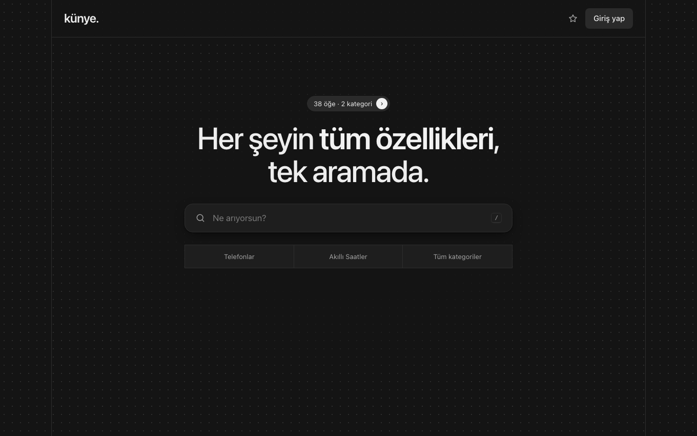
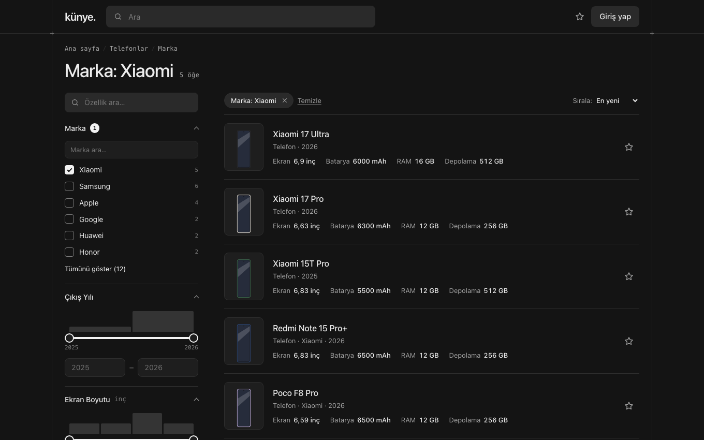
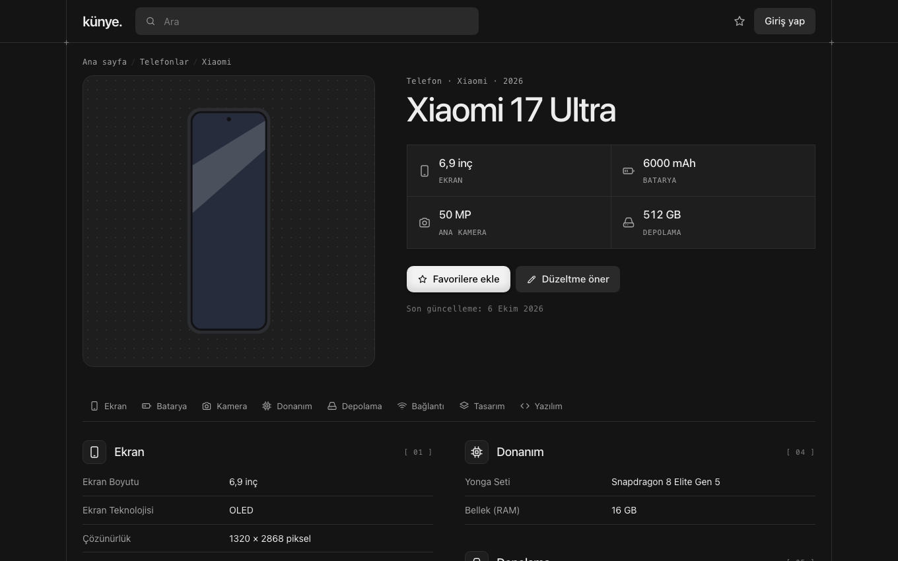

# künye

Paylaşımlı hostingte çalışan, sade ve hızlı bir **özellik kataloğu**. epey.com'dan esinlenmiştir ve her alana uyarlanabilir: telefonlar, saatler, arabalar, tarifler, kitaplar… Her kategorinin kendi özellik şablonu vardır; ziyaretçiler değerlere tıklayarak benzerlerini bulur, filtreler ve öneri gönderir.

- Saf PHP 8.2+, harici kütüphane yok, derleme adımı yok, Node.js yok.
- Veritabanı: SQLite (tek dosya). Kurulumda veritabanı bilgisi istenmez.
- JavaScript olmadan da çalışır; JS yalnızca deneyimi hızlandırır.
- Lisans: MIT



| Liste ve filtreler | Detay sayfası |
|---|---|
|  |  |

**Hemen kurmak için:** [Sürümler](../../releases/latest) sayfasından `kunye-…zip` dosyasını indir ve aşağıdaki [Hostinger'e kurulum](#hostingere-kurulum-adım-adım) adımlarını izle. Yazılım bilgisi gerekmez; tüm kurulum tarayıcıdan yapılır.

İlk tasarım taslakları [`design/`](design/) klasöründedir; HTML dosyalarını tarayıcıda açabilirsin.

---

## Özellikler

**Ziyaretçi**
- Google benzeri ana sayfa: logo sol üstte, arama kutusu tam ortada.
- Yazarken öneriler gelir: ikonlu kategoriler, küçük görselli öğeler ve özellik değerleri. Arama Türkçe karakterlere duyarsızdır; “sarj” yazınca “Şarj” bulunur.
- Detay sayfasında her değer tıklanabilir. Tıklayınca o değere tam olarak sahip öğeler listelenir ve ilgili filtre solda en üstte, aralık çubuğuyla açılır.
- Liste sayfasında filtreler tiplere göre kendiliğinden oluşur ve her seçeneğin yanında sayısı yazar. Filtre durumu paylaşılabilir bir adreste durur: `/telefon?dahili-depolama=256..1024&marka=xiaomi`
- Görseller WebP biçiminde (destekleniyorsa AVIF de) birkaç genişlikte üretilir ve `<picture>`/`srcset` ile sunulur.

**Roller**

| Rol | Yapabildikleri |
|---|---|
| Yönetici | Kategoriler ve şablonlar, kullanıcılar, ayarlar ve bakım (editörün her şeyi de dahil) |
| Editör | Öğeleri ekler ve düzenler, önerileri onaylar, değerleri temizler |
| Kullanıcı | Favori ekler (yıldız), düzeltme ve yeni öğe önerir |

**Şablonlar**
- Gruplar ikonludur. Özellik tipleri: sayı (birimli), tek seçim, çoklu seçim, var/yok, metin.
- Şablondaki bir özellik tek bir öğede gizlenebilir. Bir öğeye özel özellik ya da grup da eklenebilir.
- Tip değiştirilince değerler dönüştürülür; dönüştürülemiyorsa değişiklik reddedilir. Özellikler silinmek yerine arşivlenir, böylece değerleri kaybolmaz.

**Öneri sistemi**
- Kullanıcı, detay sayfasında değerleri yerinde düzenleyip kaynak bağlantısıyla gönderir.
- Editör her değişikliği tek tek onaylar ya da düzelterek onaylar. Onaylanan değişiklikler hemen yayına girer ve öğe geçmişine kaydedilir.
- Sistem benzer mevcut değerler için uyarır. Karşılaştırma kelime düzeyindedir: “Shield Glass 2.0” yazılınca “Xiaomi Shield Glass” önerilir, ama “OLED” ile “AMOLED” farklı sayılır.

**Veri temizliği**
- Panel → Değerler ekranında her özelliğin değerleri kullanım sayılarıyla listelenir. Değerler yeniden adlandırılabilir ve birleştirilebilir.
- Büyük/küçük harf ve Türkçe karakter farkları zaten tek değer olarak saklanır: “Oled” girilirse var olan “OLED” kullanılır.

---

## Neden SQLite?

| | SQLite | MySQL/MariaDB |
|---|---|---|
| Kurulum | Hiçbir bilgi gerekmez, `data/` klasörüne tek dosya yazılır | Veritabanı ve kullanıcı oluşturup bilgileri girmek gerekir |
| Okuma hızı | Aynı süreç içinde çalışır, ağ gidiş-dönüşü yoktur | Her sorguda ayrı sunucuya bağlanılır |
| Yedek | Tek dosya (panelden indirilir) | Dışa aktarma gerekir |
| Eşzamanlı yazma | WAL modunda okuyucular beklemez; yazmalar sırayla yapılır | Daha iyi |

Katalog okuma ağırlıklıdır. Yazmalar seyrektir: editör kaydı, favori, öneri. Binlerce öğe ve yüzbinlerce değer satırı için SQLite fazlasıyla yeterlidir (aşağıdaki ölçümlere bakın) ve kurulumu en basit seçenektir.

---

## Hostinger'e kurulum (adım adım)

### 1. PHP sürümü ve eklentiler

1. hPanel → **Web siteleri** → sitenin yanındaki **Yönet**.
2. **Gelişmiş → PHP Yapılandırması**. Sürüm olarak **PHP 8.2** ya da üstünü seç ve kaydet.
3. Aynı ekranın **PHP Eklentileri** sekmesinde şunların işaretli olduğunu doğrula: `pdo_sqlite`, `sqlite3`, `mbstring`, `fileinfo`, `gd`. Varsa `imagick` da işaretlenebilir; künye o zaman Imagick'i tercih eder.

### 2. Dosyaları yükle — ZIP ile (önerilen)

1. [Sürümler](../../releases/latest) sayfasının **Assets** bölümünden `kunye-<sürüm>.zip` dosyasını indir. Kaynaktan çalışıyorsan `php tools/paketle.php` komutu paketi `dist/` klasöründe oluşturur.

   > GitHub'daki yeşil **Code → Download ZIP** düğmesini kullanma. O arşiv dosyaları `kunye-main/` adlı bir klasörün içine koyar; açtığında site `alanadin.com/kunye-main/` adresinde çalışır. Ayrıca testleri ve taslakları da içerir. Sürümler sayfasındaki ZIP doğrudan `public_html` içine açılmak üzere hazırlanmıştır.
2. hPanel → **Dosyalar → Dosya Yöneticisi** → `public_html` klasörünü aç.
3. Klasörde Hostinger'in koyduğu `default.php` dosyası varsa sil.
4. **Yükle** düğmesiyle ZIP'i yükle. Ardından dosyaya sağ tıkla → **Çıkart**. Hedef olarak `public_html` klasörünü seç.
5. Klasörde `index.php`, `.htaccess`, `app/`, `assets/`, `data/` ve `uploads/` görünmeli. Gizli dosyaları göstermek için Dosya Yöneticisi'nin ayarlarından “gizli dosyaları göster” seçeneğini açabilirsin.

> **FTP ile:** Hostinger'in FTP bilgileriyle (hPanel → Dosyalar → FTP Hesapları) ZIP'in içindekileri `public_html` klasörüne yükle. `.htaccess` ve `.user.ini` nokta ile başlar; FTP istemcinde gizli dosyaların gösterildiğinden emin ol.

> **Git ile:** hPanel → **Gelişmiş → Git**. Depo adresini ve dalı (`main`) gir, kurulum yolunu boş bırak (`public_html`) ve **Dağıt**'a bas. `data/` ve `uploads/` içerikleri git'e girmez, bu yüzden sonraki dağıtımlar verine dokunmaz. `tests/`, `tools/`, `design/` ve `docs/` klasörleri de yüklenir, ama `.htaccess` onları dışarıya kapatır.

### 3. Kurulum ekranı

1. Tarayıcıda `https://alanadin.com/kurulum` adresini aç.
2. Ekran gereksinimleri ve yazma izinlerini denetler. Ayrıca `data/` klasörünün dışarıdan okunamadığını kendi adresine istek atarak doğrular.
3. Kırmızı işaretli bir satır varsa:
   - **PDO SQLite / GD yok:** 1. adımdaki eklentileri aç.
   - **`data/` yazılamıyor:** Dosya Yöneticisi'nde `data` ve `uploads` klasörlerine sağ tıkla → **İzinler** → `755` yap.
   - **`data/` koruması AÇIK:** `.htaccess` dosyaları yüklenmemiş demektir; ZIP'i yeniden çıkart.
4. Site adını, ilk yönetici hesabını ve şifreyi gir. İstersen “Örnek veriyi yükle” seçeneğini işaretli bırak: 30 telefon, 8 akıllı saat ve iki örnek öneri yüklenir.
5. **Kur ve kilitle** düğmesine bas. Kurulum bitince `data/kurulum.kilit` dosyası oluşur ve `/kurulum` adresi 404 döner.

### 4. HTTPS

hPanel → **Güvenlik → SSL** bölümünden ücretsiz sertifikayı kur ve **HTTPS'ye zorla** seçeneğini aç. künye HTTPS'de oturum çerezlerini otomatik olarak `Secure` işaretler ve HSTS başlığı gönderir.

### Alt klasöre kurulum

ZIP'i `public_html/katalog/` gibi bir alt klasöre çıkartman yeterli. Uygulama kök yolunu kendisi bulur; `RewriteBase` ya da başka bir ayar gerekmez. Kurulum adresi bu durumda `https://alanadin.com/katalog/kurulum` olur.

---

## İlk adımlar

1. **Panel → Kategoriler → Yeni kategori**: çoğul ad (Telefonlar), tekil ad (Telefon), adres (`telefon`), ikon ve isteğe bağlı bir bölüm (ör. “Mobil”). Bölümler yalnızca gruplama içindir.
2. Şablona gruplar ve özellikler ekle. Her özelliğin “⋯” menüsünde şu ayarlar var:
   - **Listede göster:** liste satırında en fazla 4 özellik.
   - **Öne çıkan:** detay sayfasının üstünde en fazla 4 özellik.
   - **Alt başlıkta göster:** ör. marka ve yıl. Bunlar adın üstünde görünür ve aramaya dahil edilir.
   - **Detay sayfasında tıklanabilir**, **Zorunlu**, **Arşivle**.
3. **Panel → Öğeler → Yeni öğe**: öğe taslak olarak açılır. Değerleri ve görselleri ekleyip durumu **Yayında** yap.
4. **Panel → Kullanıcılar**: editör ekle. Kayıt açıksa kullanıcılar `/kayit` adresinden kendi hesaplarını açar. Bu ayar Panel → Ayarlar'dan değiştirilebilir.

### Adresler

| Adres | Sayfa |
|---|---|
| `/telefon` | Kategori listesi ve filtreler |
| `/telefon/xiaomi-17-ultra` | Öğe detayı |
| `/telefon/xiaomi-17-ultra/duzelt` | Düzeltme önerisi (giriş gerekir) |
| `/telefon/oner` | Yeni öğe önerisi |
| `/ara?q=…` | Tüm arama sonuçları |
| `/panel` | Yönetim paneli |

Filtre sözdizimi:

| Tip | Örnek |
|---|---|
| Sayı | `?ekran-boyutu=6.5..6.9` aralık · `?dahili-depolama=512` tam değer · `?kapasite=6000..` alt sınır |
| Tek seçim | `?marka=apple,xiaomi`, seçilenlerden herhangi biri |
| Çoklu seçim | `?ekran-ozellikleri=ltpo,hdr10`, seçilenlerin hepsi |
| Var/yok | `?kablosuz-sarj=var` |
| Sıra ve sayfa | `&sirala=populer`, `&sirala=az`, `&sayfa=2` |

---

## Güvenlik

- **Dışarıya kapalı:** Kaynak kod, veritabanı ve yapılandırma dosyaları `.htaccess` ile kapatılır. Kök `.htaccess` dosyası yalnızca `assets/` ve `uploads/` altındaki görsel, CSS ve JS dosyalarını doğrudan sunar; geri kalan her istek `index.php` üzerinden geçer. `app/`, `data/`, `tests/` ve `tools/` klasörlerinin her birinde ayrıca `Require all denied` kuralı vardır.
- **CSRF:** Tüm POST isteklerinde oturuma bağlı bir belirteç ve `Origin` başlığı denetlenir.
- **Oturum:** Çerezler `HttpOnly`, `SameSite=Lax` ve HTTPS'de `Secure` olarak ayarlanır. Strict mode açıktır, girişte oturum kimliği yenilenir, şifre değişince eski oturumlar düşer. “Beni hatırla” belirteçleri tek kullanımlıktır ve veritabanında yalnızca özetleri saklanır.
- **Şifreler:** `password_hash` ile saklanır ve gerektiğinde otomatik olarak yeniden özetlenir. Giriş ve kayıt denemeleri hız sınırına tabidir.
- **Açık yönlendirme:** `donus` gibi parametreler yalnızca uygulama içindeki göreli yolları kabul eder.
- **Yükleme doğrulaması:** Boyut, MIME türü (`finfo`) ve piksel sınırı denetlenir. Görsel yeniden kodlanır ve özgün dosya saklanmaz. `uploads/` klasöründe betik çalıştırılamaz.
- **Başlıklar:** Content-Security-Policy (satır içi betik yok), `X-Content-Type-Options`, `X-Frame-Options`, `Referrer-Policy`.

İsteğe bağlı olarak veri klasörünü web kökünün dışına taşıyabilirsin. Örneğin `/home/u123456789/kunye-data` oluşturup `data/` içeriğini oraya taşı ve kök `.htaccess` dosyasına şu satırı ekle:

```apache
SetEnv KUNYE_DATA /home/u123456789/kunye-data
```

---

## Performans

- Her kategori için bir filtre dizini (öğe ↔ değer kümeleri) PHP dosyası olarak `data/cache/dizin/` altına yazılır. OPcache sayesinde neredeyse hiç maliyeti olmadan okunur ve kategori her değiştiğinde sürüm numarasıyla yenilenir.
- Giriş yapmamış ziyaretçilere sayfalar tam sayfa önbellekten verilir (`X-Kunye-Cache: hit`). İçerik değişince önbellek kendiliğinden geçersiz olur.
- Arama, Türkçe katlanmış ayrı sütunlarda yapılır. İndeksler sık kullanılan sorgulara göre kurulmuştur (`vals(prop_id, num)`, `vals(option_id, item_id)`…).

`php tools/kiyasla.php 5000` ölçümü (5.030 öğe, ~190.000 değer satırı, dizüstü bilgisayar):

| İşlem | Süre |
|---|---|
| Filtresiz liste | 11 ms |
| `?marka=samsung` | 3 ms |
| `?dahili-depolama=256..1024&marka=apple,xiaomi` | 4 ms |
| Arama önerisi | 2 ms |
| Dizinin sıfırdan oluşturulması (değişiklikten sonraki ilk istek) | 104 ms |

---

## Yedekleme ve güncelleme

- **Yedek:** Panel → Ayarlar → Bakım → **Veritabanı yedeği → İndir**. Tutarlı bir kopya üretilir (`VACUUM INTO`). Görseller `uploads/` klasöründedir; onları Dosya Yöneticisi'nde klasöre sağ tıklayıp **Sıkıştır** ile indirebilirsin.
- **Güncelleme:** Yeni ZIP'i aynı klasöre çıkartıp üzerine yaz. Paketteki `data/` ve `uploads/` klasörlerinde yalnızca koruma dosyaları olduğu için verin silinmez. Şema değişiklikleri ilk istekte kendiliğinden uygulanır.
- **Önbellek:** Panel → Ayarlar → Bakım → **Önbelleği temizle** ve **Arama dizinini yeniden oluştur**.

---

## Sorun giderme

| Belirti | Çözüm |
|---|---|
| `/kurulum` 404 veriyor | `.htaccess` yüklenmemiş ya da mod_rewrite kapalı. Gizli dosyaları gösterip `.htaccess`'in yerinde olduğunu kontrol et. |
| 500 hatası | `data/logs/hata.log` dosyasına bak. Ayrıntılı hata görmek için geçici olarak boş bir `data/hata-ayikla` dosyası oluştur, sonra sil. |
| Görsel yüklenmiyor / “Dosya çok büyük” | `.user.ini` sınırı 20 MB'tır. hPanel → PHP Yapılandırması → `upload_max_filesize` değerini artır. |
| AVIF üretilmiyor | Sunucunun GD/Imagick kurulumu AVIF desteklemiyor. WebP yeterlidir; Panel → Ayarlar'da durumu görebilirsin. |
| Şifremi unuttum | Bir yönetici Panel → Kullanıcılar'dan kilit ikonuyla tek kullanımlık bir sıfırlama bağlantısı üretip sana iletir. Yönetici şifresini unuttuysan `data/kunye.sqlite` dosyasını bir SQLite aracıyla açıp yeni bir `password_hash` yazman gerekir. |

---

## Geliştirme

```bash
php -S localhost:8000 index.php
```

Ardından `http://localhost:8000/kurulum` adresini aç. Yerleşik sunucu `.htaccess` dosyasını okumaz; bunun yerine `index.php` yalnızca `assets/` ve `uploads/` klasörlerindeki dosyaları doğrudan sunar.

```bash
php tests/run.php
```

Birim ve entegrasyon testleri (24 test) geçici bir veritabanında çalışır.

```bash
php tests/smoke.php
```

Gerçek bir sunucu başlatıp kurulumu, sayfaları ve korumaları dener (38 denetim).

```bash
php tools/paketle.php
```

Yükleme paketini `dist/kunye-<sürüm>.zip` olarak üretir.

### Dosya yapısı

```
index.php            tek giriş noktası
.htaccess            yönlendirme ve erişim kuralları
.user.ini            yükleme ve bellek sınırları
app/
  bootstrap.php      sabitler, otomatik yükleme
  routes.php         adresler
  lib/               Db, Schema, Catalog, Facets, Search, Images, Suggestions, Values, Templates, Auth…
  controllers/       sayfa denetleyicileri
  views/             PHP şablonları (site/, panel/, partials/)
assets/              css/, js/, ikonlar.svg
data/                veritabanı, önbellek, oturumlar, günlükler (dışarıya kapalı)
uploads/             üretilen görseller
design/              ilk HTML/CSS taslakları
docs/                README ekran görüntüleri
tests/  tools/       testler ve geliştirme araçları (pakete girmez)
```

Kod düzeni: saf PHP 8.2 sınıfları, ad alanı yok. Her sınıf `app/lib` ya da `app/controllers` altında kendi adıyla bir dosyadadır. Şablonlarda tüm çıktılar `e()` ile kaçışlanır. Tüm SQL sorguları PDO ile hazırlanmış ifadeler olarak çalışır.

## Lisans

MIT. Ayrıntılar için [LICENSE](LICENSE) dosyasına bak. Örnek verideki ürün değerleri gösterim amaçlıdır.
